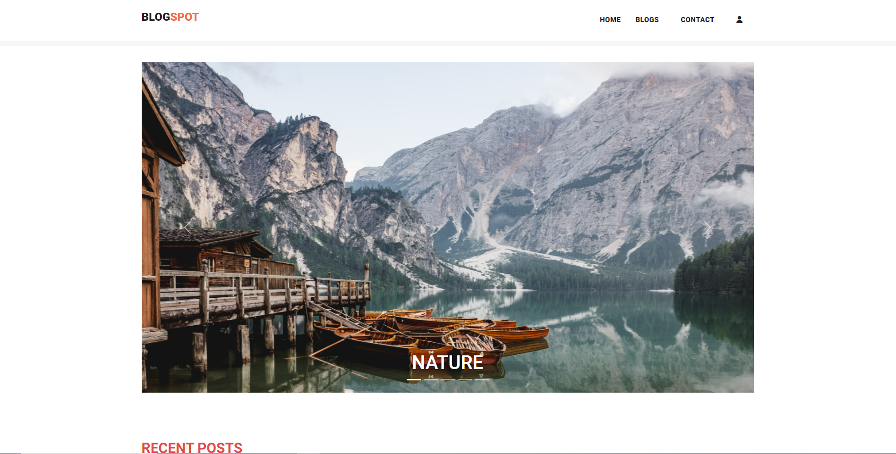
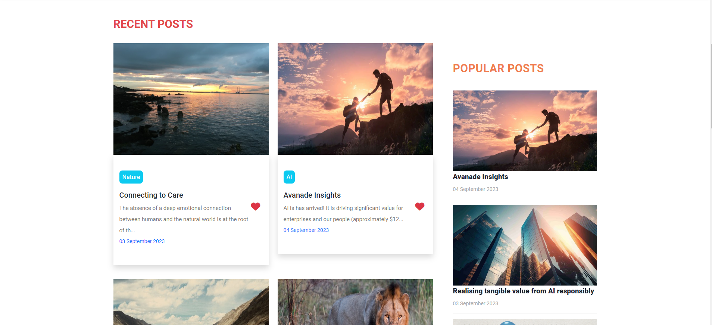
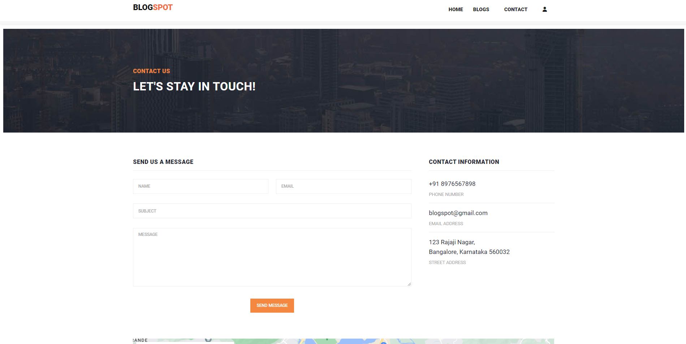
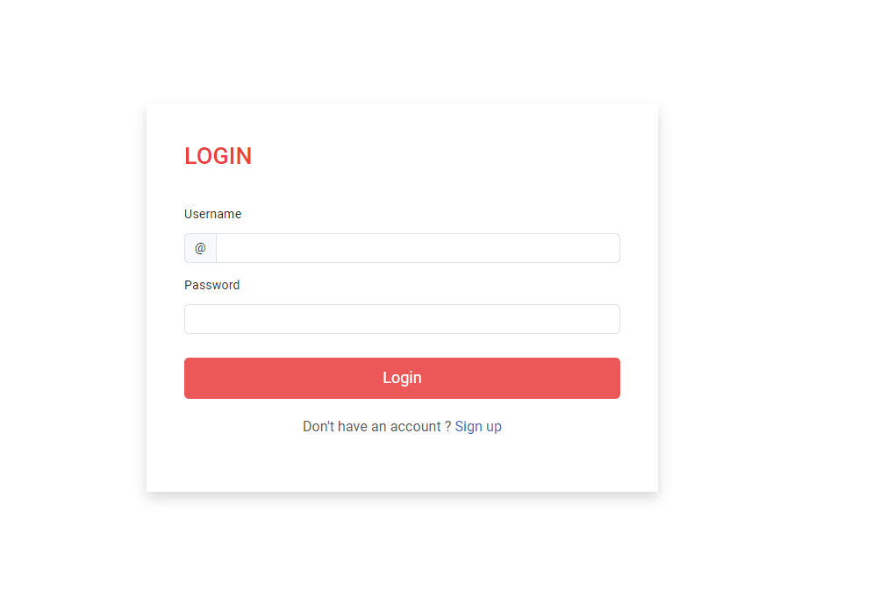
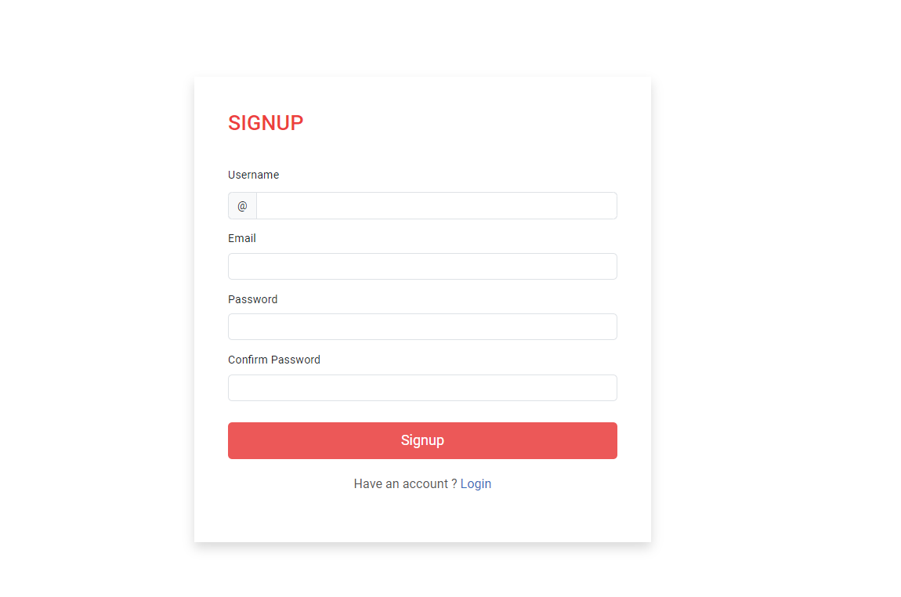

# Blog Website

A Blog application built using Django that provides features such as user login/register, creating blog posts with a title, description and image, and editing or deleting blog posts.

## 📃 Description

This Django Blog Website provides an interactive interface where users can view and manage blog posts. It also includes an admin panel for managing blog posts and users.

## Features

* **Manage Blog** – Create, edit, and delete blog posts using CRUD operations.
* **Login System** – Users can register and log in to the system.
* **Blog** – Users can create and manage blog content.
* **Media** – Upload and manage images used in blog posts.
* **Template** – Responsive user interface built using HTML, CSS, and JavaScript.

## 🛠 Built With

* HTML
* CSS
* JavaScript
* Python
* Django
* SQLite Database

The backend is developed using the Django framework, while the frontend uses HTML, CSS, and JavaScript.

## 🚀 Project Repository

To view the project, visit:

**GitHub:**
https://github.com/Harshini1428/blogging-website

## 🖼️ Project Preview

## ⭐ Show Your Support

If you like this project, consider giving it a ⭐ on GitHub!
